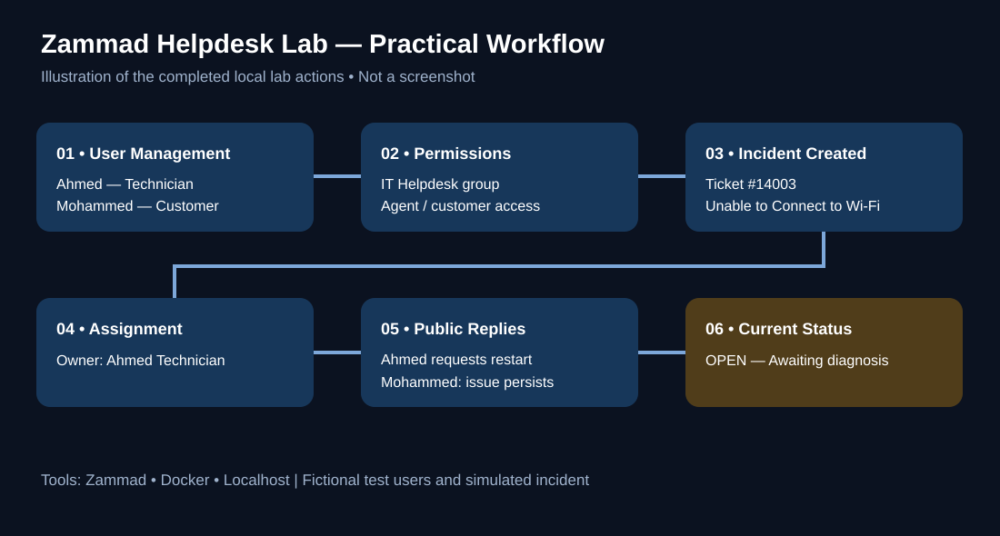

# Zammad IT Helpdesk Lab

**Hands-on IT Service Management (ITSM) lab** · Zammad · Docker · Local environment

This repository documents a simulated helpdesk workflow, using fictional employee and technician accounts. It is **not** a custom-built Zammad product or a production deployment.

## Practical workflow

1. Configured a local Zammad environment.
2. Created sample users **Ahmed Technician** and **Mohammed Employee**.
3. Practiced IT Helpdesk group permissions and ticket ownership.
4. Managed **ticket #14003 — Unable to Connect to Wi-Fi**.
5. Assigned the ticket to Ahmed and sent a public technician response.
6. Replied as Mohammed that the issue persisted.
7. Left the ticket **Open** for further troubleshooting.

## Visual walkthrough

> The diagram is an **illustration of the actions performed**, not a Zammad screenshot. Original screenshots have not yet been published in this repository.

## Original screenshot evidence

The following are actual photographs from the local lab. The final enhanced images are available in the documentation archive; they will appear below once the `evidence/` images are uploaded to this repository.

| Evidence | What it shows |
|---|---|
| 01 — Local Helpdesk | Zammad dashboard |
| 02 — User Management | Sample user directory |
| 03 — Access Control | Group permissions |
| 04 — Dashboard View | Additional dashboard view (not a ticket conversation) |
| 05 — Customer Response | Mohammed's unresolved Wi-Fi reply |
| 06 — Ticket Assignment | Ticket ownership and status controls |

## Skills

IT Support · ITSM · Ticketing Systems · Zammad · Docker · User Administration · Access Permissions · Incident Tracking · Customer Communication

## Documentation

- [Practical workflow](docs/practical-evidence.md)
- [Lab notes](docs/lab-workflow.md)
- [Resume entry](docs/resume-entry.md)
- [Publication checklist](docs/publication-checklist.md)

> **Accuracy:** The Wi-Fi problem was simulated and not resolved. No screenshots are represented as proof of steps they do not show. Any workflow illustration is labeled as an illustration rather than a real screenshot.

## Reproducible technical examples

The original exercise was performed in the Zammad web UI. To make this repository useful for technical review, it also includes **additional example scripts (not executed as part of the original lab)**:

- [Hands-on commands and setup](docs/hands-on-commands.md)
- [API connection check](scripts/check-zammad-api.sh)
- [Read-only ticket listing](scripts/list-tickets.sh)
- [Optional demo ticket creation](scripts/create-demo-ticket.sh)
- [Docker Compose deployment guidance](examples/docker-compose.yml)

> The illustrative workflow image has not yet been committed to this repository. It must be labeled as an illustration and should not be presented as an actual Zammad screenshot.
