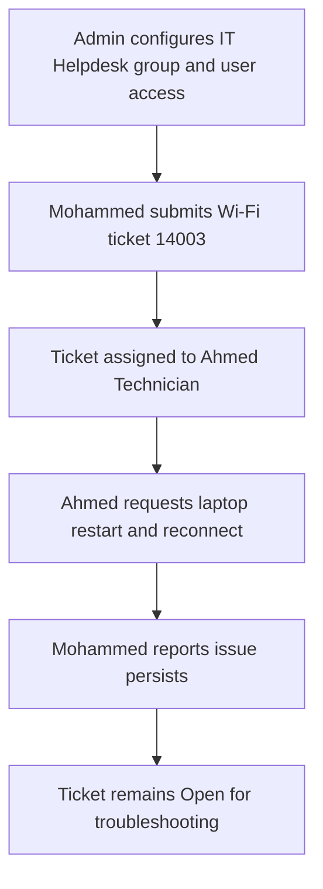

# Practical Lab Evidence

This lab was completed in a **local Zammad environment** using fictional test accounts.

## What was actually practiced

| Stage | Practical action | Evidence |
| --- | --- | --- |
| 1 | Opened the self-hosted Zammad environment | Local dashboard screenshot |
| 2 | Created test users Ahmed Technician and Mohammed Employee | User-management exercise |
| 3 | Configured IT Helpdesk group and access permissions | Group-permissions screenshot |
| 4 | Opened Wi-Fi connectivity incident #14003 | Ticket screenshot |
| 5 | Assigned ticket ownership to Ahmed Technician | Ticket-assignment screenshot |
| 6 | Sent a public support reply as Ahmed | Ticket conversation |
| 7 | Replied as Mohammed that Wi-Fi was still not working | Customer response screenshot |
| 8 | Kept the ticket open for further investigation | Ticket state: Open |

## Ticket workflow

## Screenshot policy

The original photos from the local lab are **not yet uploaded** to this public repository. The screenshots must be checked for sensitive data and rotated/cropped for readability before publication. Any generated workflow illustration must be labeled **Illustration**, not a screenshot of completed work.

This is a hands-on lab, not a custom Zammad application or a production deployment.
